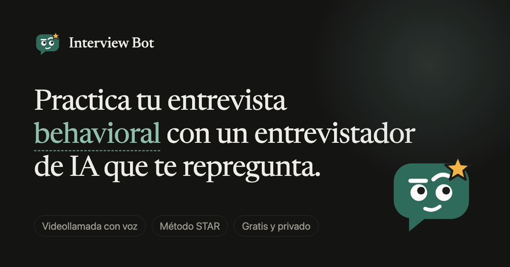

# Interview Bot

Practice behavioral interviews (STAR, Amazon's Leadership Principles, Google, Meta, startups) with an AI interviewer that talks to you on a simulated video call, follows up on vague answers, takes notes and gives you a hiring-committee verdict at the end.

It runs entirely in your browser: no accounts, no database, and no API keys of ours. Use Chrome's built-in AI on your own device for free, or bring your own key.



**Try it:** [interview-bot-murex.vercel.app](https://interview-bot-murex.vercel.app)

## What it does

- **Set up in one sentence.** _"Practice a behavioral interview at **Senior** level for **Software Engineer** in the style of **Amazon**, focused on **conflict**."_ Every highlighted word is a picker.
- **A video call, not a chat.** The interviewer speaks (browser voice, OpenAI TTS or ElevenLabs) and you answer by voice or by typing. Live captions and a full transcript are on by default.
- **An interviewer that acts like one.** With models that support tool use, it takes notes with your exact words, checks which criteria still lack evidence before choosing the next question, and hangs up when it's done. Models without tools run in a clearly labeled basic mode.
- **Knows your background.** Upload your CV or your LinkedIn PDF and it asks about your real projects. Only a short summary is kept, never the file.
- **Results you can act on.** A verdict on the committee's scale, scores on six criteria (STAR structure, specifics, ownership, impact, scope for your level, communication), the interviewer's notes with quotes, and one concrete exercise for next time. Your next interview presses on your weak spots.
- **Bilingual and accessible.** The app runs in Spanish or English, and the interview language is set separately. It targets WCAG 2.2 AA: keyboard, screen readers, high-contrast mode and reduced motion.

## Privacy model

| What                                                 | Where it lives                                                                                                                                                                   |
| ---------------------------------------------------- | -------------------------------------------------------------------------------------------------------------------------------------------------------------------------------- |
| Profile, settings, history, API keys                 | Your browser's `localStorage`                                                                                                                                                    |
| Requests to OpenAI / Anthropic / Gemini / OpenRouter | Sent through a stateless proxy that logs and stores nothing (it exists only because providers block browser calls)                                                               |
| Multi-device sync (optional)                         | Encrypted end to end with your own Nostr key (NIP-44) and published to public relays, which see only ciphertext. API keys sync only if you turn it on, behind an extra password. |

Chrome's built-in AI never leaves your device.

## Run it locally

Requirements: Node.js 22 or newer.

```bash
git clone https://github.com/CrisTowi/interview-bot.git
cd interview-bot
npm install
npm run dev
```

Open http://localhost:5173. To get answers from the interviewer, either:

- **Use Chrome's built-in AI** (free, on device) in a recent desktop Chrome. If Settings says it's unavailable, turn on `chrome://flags/#prompt-api-for-gemini-nano` and restart Chrome.
- **Or add a key** in Settings → AI engine: OpenAI, Anthropic, Gemini or OpenRouter (which also has free models).

`npm run dev` also serves the `/api` proxy, so you don't need the Vercel CLI.

## Deploy your own

Import the repository at [vercel.com/new](https://vercel.com/new). Vercel detects Vite and needs no environment variables. The site is static and the proxy only runs when someone uses their own key, so it fits the free Hobby plan.

## Contributing

Contributions are welcome. [CONTRIBUTING.md](CONTRIBUTING.md) covers setup, the test suites, coding standards and how pull requests are reviewed. [docs/ARCHITECTURE.md](docs/ARCHITECTURE.md) explains how the pieces fit together.

Found a security issue? See [SECURITY.md](SECURITY.md).

## License

[MIT](LICENSE). The accessibility review skill in `.claude/skills/accessibility/` comes from [addyosmani/web-quality-skills](https://github.com/addyosmani/web-quality-skills) (MIT).
